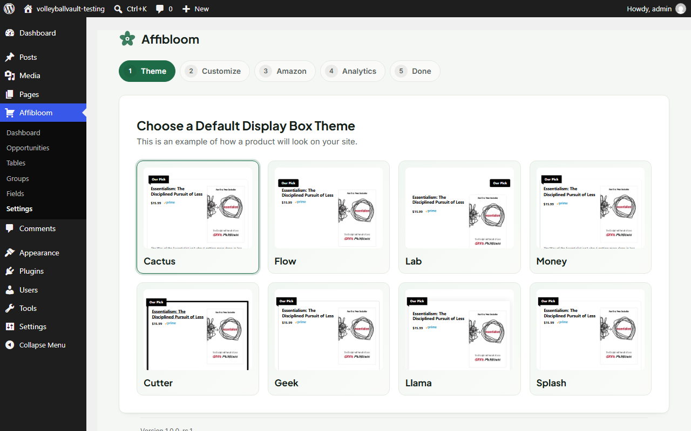
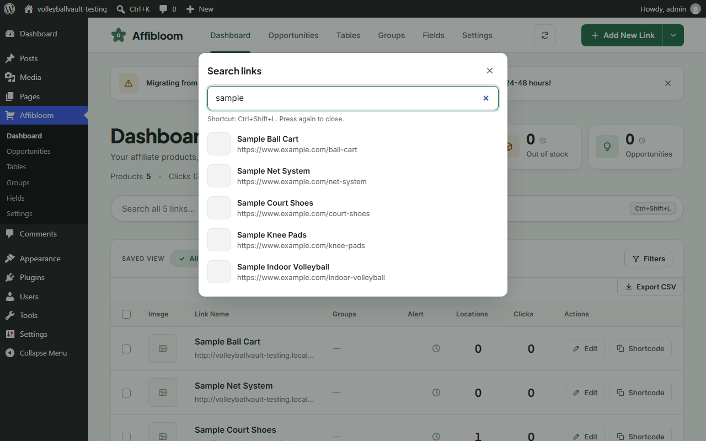
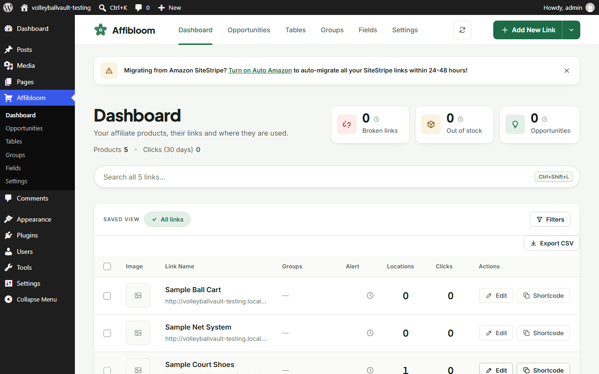
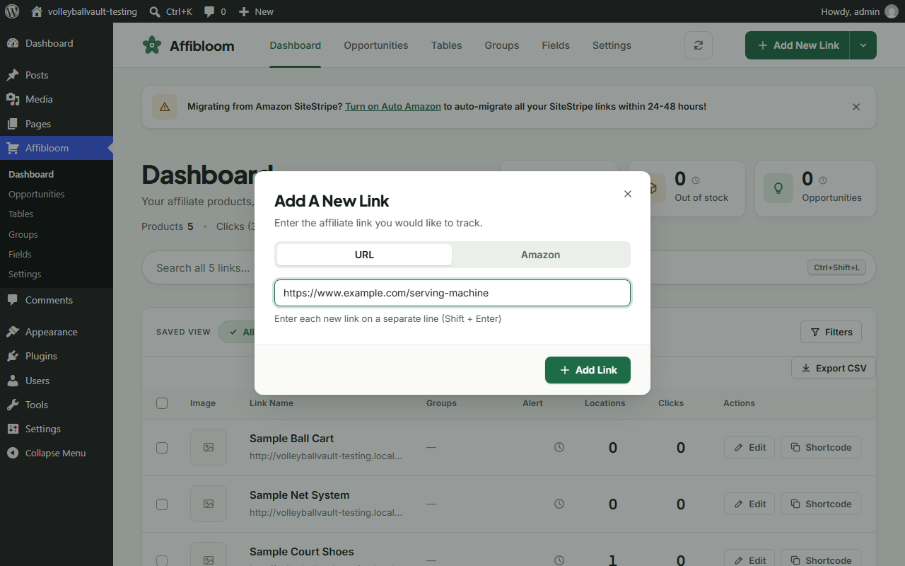
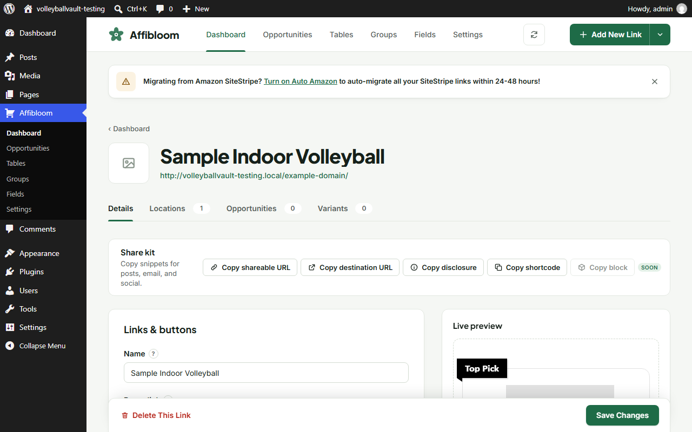
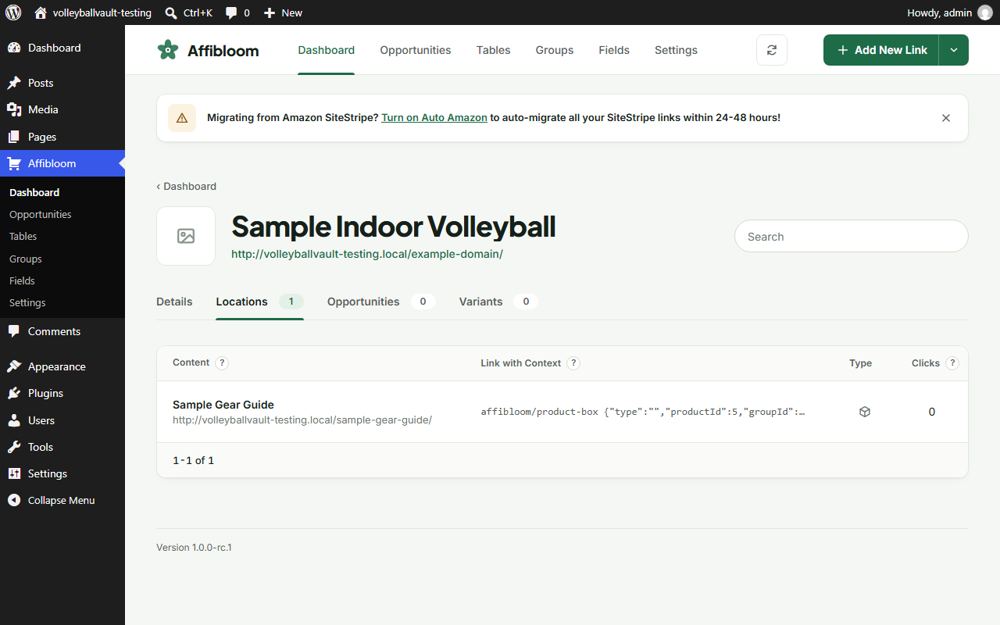
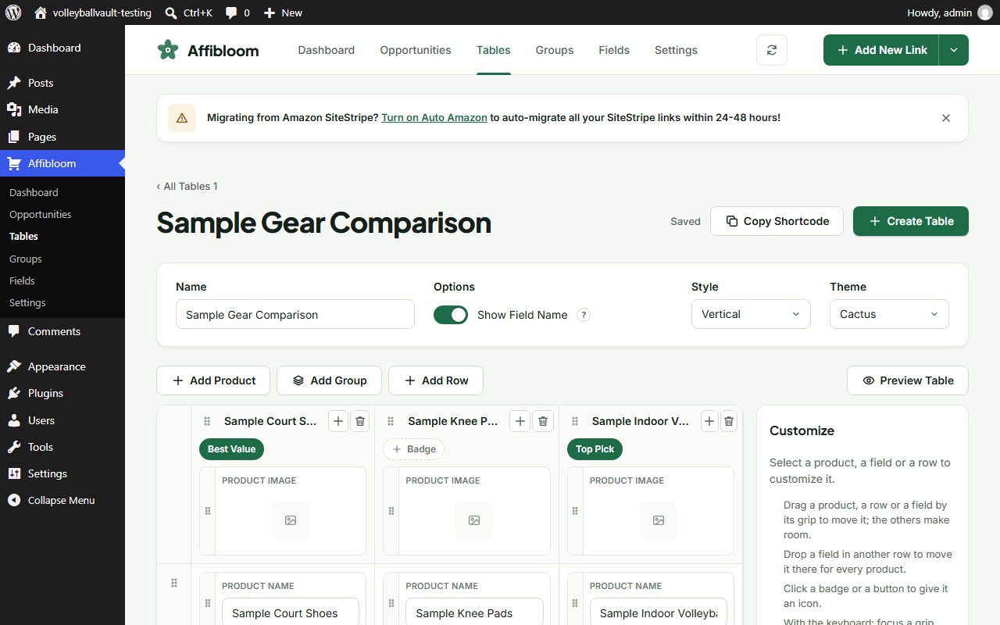
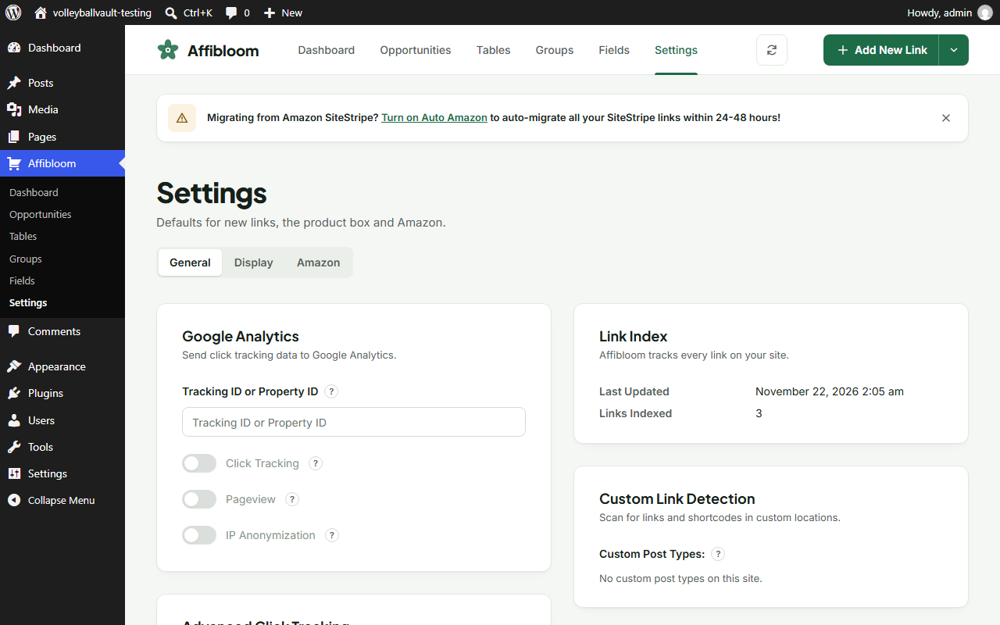
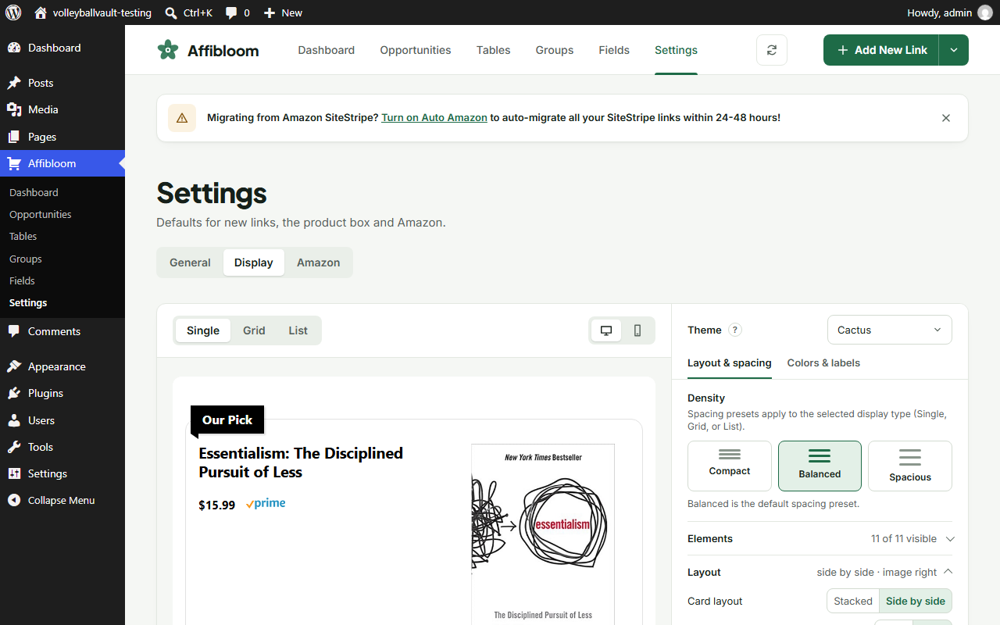
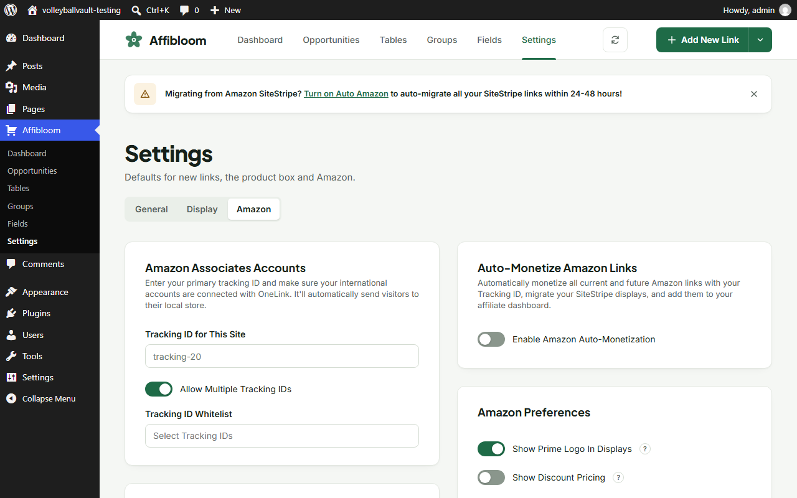

# Affibloom admin guide

For the site's owner and editors: what Affibloom does, where each Lasso feature went, and what it needs from you.
The developer's side (entry points, stored data, tests, releases) is in [`developer.md`](developer.md).

Affibloom keeps your affiliate products in one library and draws them in posts as product boxes, buttons, grids,
lists and comparison tables. It checks the links, counts clicks, finds where each product is used and finds links you
could still monetize. It works on its own: it needs no Lasso code, account, licence or cloud.

Screens shown here are from a test site with placeholder products.

## Contents

1. [First run: the setup wizard](#1-first-run-the-setup-wizard)
2. [Getting around](#2-getting-around)
3. [The Dashboard](#3-the-dashboard)
4. [Adding products](#4-adding-products)
5. [A product's page](#5-a-products-page)
6. [Placing a box in a post](#6-placing-a-box-in-a-post)
7. [Groups, Fields and Tables](#7-groups-fields-and-tables)
8. [Link health](#8-link-health)
9. [Clicks and Google Analytics](#9-clicks-and-google-analytics)
10. [Locations, the link index and Opportunities](#10-locations-the-link-index-and-opportunities)
11. [Settings](#11-settings)
12. [Logs, DB Status, export and uninstall](#12-logs-db-status-export-and-uninstall)
13. [What needs Amazon credentials](#13-what-needs-amazon-credentials)
14. [Moving from Lasso](#14-moving-from-lasso)
15. [Lasso features not rebuilt](#15-lasso-features-not-rebuilt)
16. [Where Lasso's features are now](#16-where-lassos-features-are-now)

## 1. First run: the setup wizard

On a new site, the first Affibloom page you open after activating the plugin is the setup wizard (it opens by itself
once; later it is at `wp-admin/admin.php?page=affibloom-setup`). Its steps are in the bar at the top; **Skip** moves on
without saving, **Save and Continue** saves only that step's fields.

1. **Theme:** pick the default theme for every box (Cactus, Cutter, Flow, Geek, Lab, Llama, Money, Splash); each
   button shows that theme's box.
2. **Customize:** colours and the disclosure, with a live preview.
3. **Amazon:** your Amazon Associates tracking ID, Auto-Monetize Amazon Links and the Amazon preferences.
4. **Analytics:** your Google Analytics ID.
5. **You're Ready:** **Go to Dashboard** ends the wizard for good.

The same settings are under Settings at any time (section 11). A site that is moved from Lasso does not get the wizard:
the migrator brings the settings.

## 2. Getting around

### Header

Every Affibloom screen has the same header: the Affibloom name, the tabs **Dashboard**, **Opportunities**, **Tables**,
**Groups**, **Fields** and **Settings**, the **Automations** button (what is running in the background, with a count),
and **Add New Link** with a caret for **Bulk Add Links**. On a phone the tabs fold into **Menu**. Below the header,
notices appear (for example broken links, or a running Amazon sync).

In the WordPress menu, Affibloom has the same pages. Who sees them is set under Settings → General → Permissions
(administrators by default).

**Ctrl+Shift+L** (⌘⇧L on a Mac) opens **Search links** on every Affibloom screen and in the posts' lists and editors:
it lists the ten most recently changed products, narrows them as you type a name or link, and **Enter** opens the
product. Arrows move through the results, **Escape** or the shortcut again closes it. It does not open while you are
typing in another field.

## 3. The Dashboard

The Dashboard lists every product: picture, name and link, Groups, Alert, Locations, Clicks and the row's **Edit** and
**Shortcode** buttons.

- **Tiles** above the list: Broken links, Out of stock and Opportunities, each a shortcut to its tab, and the
  library's counts (products, clicks in the last 30 days).
- **Search** by name, link, ASIN or ID; the list updates as you type.
- **Filters** narrows the list by group, link type, placements and comparison table. Changes apply as you toggle.
  **Save as** stores the current filters as a **saved view**; your views are the chips above the list (yours only).
- **Tabs** Broken links, Out of stock and Opportunities show only those products, oldest issue first.
- **Sort** by clicking Alert, Locations or Clicks in the header row.
- **Edit** opens a quick edit of the product in the list; the name opens its page. **Shortcode** copies the product's
  shortcode.
- **Select** rows to delete them or add them to a group. **Export CSV** downloads the list as it is filtered (on the
  issue tabs), or the whole library.
- **Per page** at the bottom sets how many rows a page shows.

**The tour.** The first visit to the Dashboard walks you through it, one part at a time. **Next** and **Back** move,
**Skip** or **Done** end it for every user on the site. Clicking elsewhere or pressing Escape does not end it.

## 4. Adding products

**Add New Link** opens **Add A New Link**. Paste one link and click **Add Link**: the product is created and its page
opens. Amazon links are recognised (the ASIN, the store, your tracking ID); any other merchant's link works too.

- **Several at once:** one link per line (Shift + Enter). They are added in the background; you can stay on the
  Dashboard while they are created.
- **Bulk Add Links** (the caret beside Add New Link) is the same with a larger box.
- The **Amazon** tab (with Amazon credentials): search Amazon, select up to ten products, then **Add Link**.
- A link that already exists is reported; **Continue Anyway** adds it again when "Allow duplicate destinations" is on.

## 5. A product's page

A product's page opens from the Dashboard (its name or Edit) and has the tabs **Details**, **Locations**,
**Opportunities** and **Variants**. The live preview on the right shows the box as readers will see it. **Save
Changes** saves; leaving with unsaved changes asks first. **Delete This Link** is refused while posts still use the
product (Locations shows where).

### Product page, Details

- **Name** (shown only in displays) and **Permalink**, the slug of the product's cloaked link.
- **Links & buttons:** the primary destination and button text, and **Add Another Button** for more buttons, each with
  its own link, text, icon, New Window / Tab, NoFollow / NoIndex and Sponsored. Drag a button's grip to reorder.
- **Organize:** **Groups** the product belongs to.
- **Custom fields:** **Add Custom Field** attaches a field from the library (section 7) with this product's value, for
  example a rating, pros and cons, or a size. The Primary Rating draws stars.
- **The box's content:** the image (upload, or **Refresh** for an Amazon product), **Badge Text**, **Price** and **Show Price**,
  **Description**, **Features** and **Show Features**.
- **Disclosure & link attributes:** the disclosure text and **Show Disclosure**, **Sponsored**, **Detect
  Opportunities**, **Link Cloaking** and, for Amazon products, **Show Prime Logo**.

**Cloaking and the link prefix.** With Link Cloaking on, the product's links in posts use the site's own address
(`/<prefix>/<permalink>/`), which redirects readers to the destination. The prefix is set under Settings → General →
Cloaked Link Prefix; old prefixes keep working after a change.

### Product page, Locations

Every post, page, widget and block that uses the product (a box, a shortcode, or a plain link to its destination),
with the post's title, the kind of placement and how many clicks it brought. **Link with Context** shows the sentence
around a link. Locations come from the link index (section 10).

### Opportunities and Variants

**Opportunities** lists this product's link opportunities (section 10): plain links in your content that could
become this product's link, with search and Dismiss. **Variants** gives the product extra addresses that all lead to
its destination: another cloaked permalink for a merchant link, or another tracking ID for an Amazon product, so you can
tell channels apart (for example a newsletter) without making a second product. **Add Variant** adds one; removing a
variant stops its address.

## 6. Placing a box in a post

In the block editor, add the **Product box** block (search "affiliate" or "link"), choose the display type, then the
product, group or table. The sidebar sets the theme and the per-box texts. In the classic editor, the **Add A Display**
button does the same; in Elementor, the **Affibloom** widget. Each places the same box.

**Display types:** a single product box, a button, an image, a text link, one field's value, a group as a grid, list or
gallery, and a comparison table. The defaults for each type (theme, colours, which elements show) are under Settings →
Display.

**The shortcode** `[affibloom id="123"]` places the same box anywhere shortcodes work. The editor's **Shortcode** button
and the Dashboard's copy it for you. Common attributes:

| Attribute | What it does |
|---|---|
| `id` or `slug` | which product |
| `type` | `button`, `image`, `link`, `field`, `grid`, `list`, `gallery`, `table` (a box when left out) |
| `theme` | one of the eight themes for this box |
| `title`, `description`, `badge`, `button_text` | this box's own text instead of the product's |
| `rating` | this box's star rating |
| `compact`, `columns`, `limit` | layout of a grid or list |

**Per-box text and star ratings.** A box can show its own title, description, badge, button text and rating without
changing the product. The rating draws stars from the Primary Rating field or the box's own value.

**The icon library.** Buttons can carry an icon; Settings → Display holds the set, and any button picks from it.

Boxes load their styles only on pages that show a box (Smart CSS Loading, Settings → General).

## 7. Groups, Fields and Tables

- **Groups** keep related products together, to show them as a list, grid or gallery. **Add New Group**, then add
  products on the group's page (search, then drag to order). A product can be in several groups; Dashboard rows can be
  added to a group in bulk. A group in use cannot be deleted until its boxes are removed.
- **Fields** is the library of custom fields (text, number, rating, pros and cons, …). A field is defined once and
  given a value per product. Its page lists the products that use it.
- **Tables** are comparison tables. **Create Table**, then add products and groups of rows (fields, image, price,
  description, buttons); drag rows, columns and cards to reorder, pick a cell to change it in the inspector. A table
  shows horizontally or vertically and becomes cards on a phone. **Preview Table** shows it as readers will;
  **Locations** lists the posts that use it; a table can be cloned. Deleting a product removes it from its tables.

## 8. Link health

Every day at 03:00 (site time) Affibloom checks each product's destination; saving a product with a changed link
checks it at once. A link that answers with an error is confirmed by a second check an hour later before it is
reported.

- The **Alert** column shows a red unlink "Broken since …", an orange box "Out of stock since …", a green tick when the
  last check was clear, or a grey clock for a product added in the last 24 hours and not yet checked.
- **Broken links** and **Out of stock** tabs (and tiles) list them; **Export CSV** downloads the tab.
- A broken product's page shows "Your URL is broken."; an out-of-stock one "This product may be out of stock." Closing
  the bar hides it for 7 days.
- **Settings → Amazon → Days before out of stock alerts** waits that many days before an out-of-stock alert shows.

**Amazon products are different.** Affibloom never requests Amazon's own pages (Amazon blocks such requests, which
would look like broken links). Amazon products are checked through the Amazon Product API instead: a product Amazon no
longer has is broken, one with no stock is out of stock. **Without working Amazon credentials, Amazon products are not
checked at all**: they show no tick, and the Out of stock tab says the check needs the Amazon API. When the API is down
or refuses the credentials, that day's check is inconclusive and changes nothing.

## 9. Clicks and Google Analytics

**Clicks start from zero when Affibloom goes live.** Lasso's click figures are not imported: Lasso kept them in its
cloud, and only a 30-day snapshot exists. Affibloom counts clicks itself, on your site: one count per product, post and
button per day, without IP addresses or other personal data. Bots and repeated clicks within a short time are not
counted; this filtering is Affibloom's own and differs from Lasso's cloud, so figures will not match Lasso's. Counts are
kept for 400 days. The Dashboard shows clicks in the last 30 days; a product's Locations show clicks per post.

**Google Analytics.** With a Tracking ID or Property ID and **Click Tracking** on (Settings → General → Google
Analytics), each click is also sent to GA under Affibloom's own names. **Lasso's "Lasso …" events stop at the switch**,
so any GA report, exploration or GA4 conversion built on them must be rebuilt on the new names:

| Event | Sent when a reader clicks |
|---|---|
| `affibloom_primary_click` | a box's first button, or its title or image |
| `affibloom_secondary_click` | a box's second (or any further) button |
| `affibloom_link_click` | a product's link in the text of a post |

Each event carries the parameters `affibloom_title` (the product), `affibloom_href` (the destination),
`affibloom_text` (the clicked text) and `affibloom_badge` (the badge, if any). GA's figures for these events also start
from zero. **Pageview** loads Google's tag to count page views; leave it off if the site already loads GA another way.
**IP Anonymization** asks GA not to store full addresses.

## 10. Locations, the link index and Opportunities

**The link index** reads every post, page, reusable block and widget (and the post types and custom fields you choose
under Settings → General → Custom Link Detection) and records each link, shortcode and block that belongs to a product.
It is built after activation, kept current as posts are saved, and caught up daily. Settings → General → Link Index
shows its progress and **Rebuild Database** starts it again. Locations, the Locations column, the placement filters and
Opportunities all read it.

**Opportunities** (header tab) finds money left on the table:

- **Links:** plain links in your content to a product's destination that are not Affibloom links. **Monetize** turns
  one into the product's link without rewriting the post (the change is applied when the page is shown); **Edit in
  post** opens the editor with the link selected; **Dismiss** hides one (Undo brings it back).
- **Domains:** the outside sites you link to most, with the links found for each, including affiliate links of known
  networks (**Detected Links**).
- **Content:** posts with links that could be monetized, filterable, with a CSV export.

**Auto-detect affiliate links** (Settings → General): when a post is saved, affiliate links of known networks in it
are found and products are created for them. **Auto-Monetize Amazon Links** (Settings → Amazon): Amazon links in
content become Affibloom products in the background, every five minutes while there is work; a notice shows progress
and the Dashboard shows the import's status. Amazon short links (`amzn.to`) are resolved once and stay as they are in
the post; readers get the full link.

## 11. Settings

Each tab saves over the page without reloading; leaving with unsaved changes asks first.

### Settings → General

- **Link Defaults:** New Window / Tab, NoFollow / NoIndex, Sponsored, Show Disclosure and Link Cloaking for new
  products; Allow duplicate destinations; Detect Opportunities; Auto-Detect Affiliate Links. **Update Link Settings**
  applies a change to existing products too.
- **Link Index:** progress and Rebuild Database (section 10).
- **Google Analytics:** Tracking ID or Property ID, Click Tracking, Pageview, IP Anonymization (section 9).
- **Advanced Click Tracking:** Page and Link-Level Tracking, the click counter of section 9.
- **Cloaked Link Prefix:** the folder of cloaked links; most sites leave it empty.
- **Custom Link Detection:** which post types and custom fields the link index reads.
- **Smart CSS Loading:** the box's styles only on pages with a box.
- **Performance:** Performance Mode and the maximum CPU level background work may use.
- **Notifications:** turn off the Amazon set-up notice, the import notices or the help tooltips.
- **Permissions:** the minimum role that can use Affibloom (only administrators can change this).
- **Uninstall:** whether deleting the plugin deletes its data (section 12), and the posts that still use Affibloom.

### Settings → Display

The defaults for each display type: **Single**, **Grid** and **List** switch in place, one save stores them all. Per
type: the theme, colours, which elements show (price, disclosure, badge, rating, features), the disclosure text, **Link
from Display Title**, **Keep Site Stripe UI** and custom CSS. The preview shows the result at desktop (1280 px) and
phone (390 px) width. **Reset Settings** returns to the defaults.

### Settings → Amazon

- **Product Data API** (Creators API): the credentials and **Validate**, the default tracking ID and store (section 13).
- **Amazon Associates Accounts:** the site's tracking ID, **Allow Multiple Tracking IDs** and the **Tracking ID
  Whitelist** (IDs Affibloom leaves alone in links).
- **Auto-Monetize Amazon Links** (section 10).
- **Amazon Preferences:** Show Prime Logo, discount pricing, Update Amazon pricing daily (and only for products used
  in content), how a link change affects the product, Days before out of stock alerts.

Three switches are kept only for their stored value and say "This worked only through an outside cloud service and has
no effect in Affibloom": Commission Upgrades, Mobile Deep Linking and Send Readers to Their Local Store (section 15).

## 12. Logs, DB Status, export and uninstall

Logs and DB Status are not in the menu (as in Lasso); open them by their address.

- **Logs** (`wp-admin/admin.php?page=affibloom-logs`): what Affibloom did in the background, by kind (Link Discovery,
  Amazon Processing, Amazon Product API Errors, Link Alerts, Duplicate Slug Changes, SQL Errors), newest file of each.
  **Enable Logs** writes them all; when off, only database errors and table repairs are written. Logs are kept 14 days.
- **DB Status** (`…page=affibloom-db-status`): Affibloom's database tables and whether each is current. A table that is
  missing or out of date is repaired by itself the first time an error names it.
- **Export:** the Dashboard's **Export CSV** downloads the whole library (with no tab chosen) or the current issue
  tab, with Lasso's 24 columns.
- **Uninstall:** deactivating Affibloom keeps everything. Deleting it keeps everything too, unless Settings → General →
  Uninstall → **Delete all Affibloom data when the plugin is deleted** is on: then every product, group, table, setting,
  count and log is removed for good. Export first. Boxes in posts then print nothing; the Uninstall card lists the posts
  that still use Affibloom, with edit links.

## 13. What needs Amazon credentials

Amazon's product data comes from the **Amazon Creators API**, which needs credentials from your Associates account
(Settings → Amazon → Product Data API, then **Validate**). Until they are entered and valid, these stay dormant:

- prices, discount pricing and the Prime logo from Amazon;
- **Refresh** of a product's image and data, and the hourly **Update Amazon pricing daily** refresh;
- **bulk Amazon sync** of existing products, and the **Amazon** search tab of Add A New Link;
- link health for Amazon products (broken and out of stock, section 8);
- **Validate** in the setup wizard.

Without credentials, everything else works: adding Amazon links (the ASIN, store and tracking ID are read from the
link), boxes with the name, image and text you set, the tracking ID in every Amazon link, cloaking, clicks, Locations,
Opportunities and Auto-Monetize Amazon Links (products are created with a placeholder name until data arrives).
Products moved from Lasso keep the name, picture and price Lasso last had; they go stale until credentials are added.

## 14. Moving from Lasso

Affibloom itself contains nothing of Lasso. The move is done once, on this site, by a separate plugin, the **Affibloom
Lasso Migrator**: it copies Lasso's products, groups, fields, tables and settings into Affibloom, converts every
`[lasso]` shortcode and Lasso block in posts to Affibloom's, removes Lasso's markers from the content and translates the
site's custom CSS for the box. Each step can be reverted. When the site is checked, its **Finish** step cleans up and the
migrator and Lasso are deleted. No legacy Lasso shortcode or block support remains in Affibloom afterwards, so the
conversion must be complete before Lasso is removed (the migrator's leftover check says so).

Import from other affiliate plugins is not part of Affibloom.

## 15. Lasso features not rebuilt

Each of these depended on Lasso's company, cloud or third parties; Affibloom works without them.

| Lasso feature | Why it is gone | What Affibloom does instead |
|---|---|---|
| Licence key, account, Update Account, the update checker | Lasso's servers | Affibloom is updated as a normal plugin. |
| Lasso Analytics and Marketplace (header and menu) | Lasso's cloud | Clicks are counted locally (section 9). |
| The cloud syncs: content statistics, link issues, link locations, links, authors, plugin list, settings and cron health, the click-count sync | they sent site data to Lasso or pulled Lasso's figures | Link health, Locations and clicks are worked out on the site. |
| Lasso's historical click figures and its "Lasso …" GA events | Lasso's cloud data and names | Clicks and GA start from zero under Affibloom's names (section 9). |
| The affiliate-programs catalogue and Program Opportunities | filled from Lasso's cloud | Opportunities finds links and domains from your own content (section 10). |
| Commission Upgrades, auto-upgrade of eligible links | Lasso's brand deals | none; the switches keep their stored value and say they have no effect |
| Mobile Deep Linking, Send Readers to Their Local Store | worked only through Lasso's link service and script | Readers go straight to Amazon with your tracking ID. |
| The JS-domain and snippet downloads | code fetched from Lasso | none needed |
| The cloud parts of the redirect (posting click IDs to Lasso) | Lasso's cloud | The local sub-ID rewrite for networks is kept. |
| Intercom chat, Segment, PostHog, Sentry | third parties receiving site data | none |
| The Help menu, Support item and "Learn" links | Lasso's help site | This guide. The help tooltips stay. |
| The review card | asks for a review of Lasso | none |
| Brag mode | Lasso's logo and sign-up link | A neutral "Brag" icon in the icon library. |
| AI text generation | Lasso's cloud service | AI Text displays show text already stored; nothing new is generated. |
| "Uninstall Lasso" (rewrote posts) | it changed content | The opt-in data removal of section 12. |
| Lasso's per-customer fixes for other sites | not this site | none |

## 16. Where Lasso's features are now

| In Lasso | In Affibloom |
|---|---|
| Lasso → Dashboard | Affibloom → Dashboard (same columns, tiles, filters, saved views) |
| Add New Link, Bulk Add Links | the header's Add New Link and its caret |
| URL Details (Details, Locations, Opportunities, Variants) | a product's page, same tabs |
| Lasso → Opportunities, Tables, Groups | the header tabs of the same names |
| Fields (inside a product) | the **Fields** header tab, plus Add Custom Field on the product page |
| Settings → General, Display, Amazon | the Settings tab, same three tabs |
| Logs, DB Status (hidden pages) | the same, `page=affibloom-logs` and `page=affibloom-db-status` (section 12) |
| Imports → Lasso | the Affibloom Lasso Migrator (section 14) |
| Imports → other plugins | not built |
| The Lasso block, `[lasso]` shortcode | the Affibloom block, `[affibloom]` shortcode (converted by the migrator) |
| The command palette (Ctrl+Shift+L) | Search links, the same shortcut (section 2) |
| The Configure wizard | the setup wizard (section 1) |
| The Dashboard tour | the same tour (section 3) |
